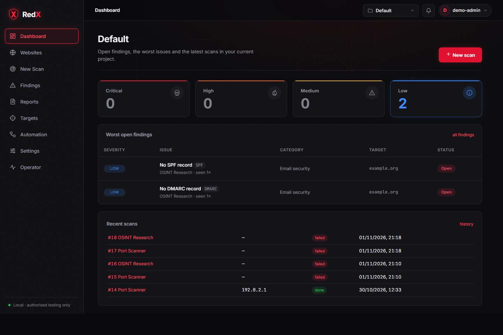
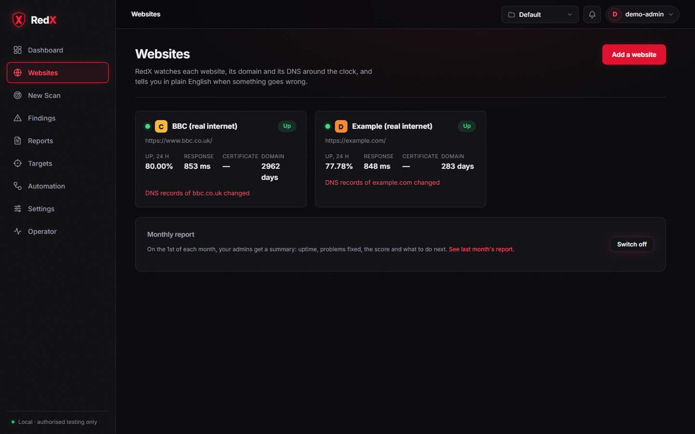
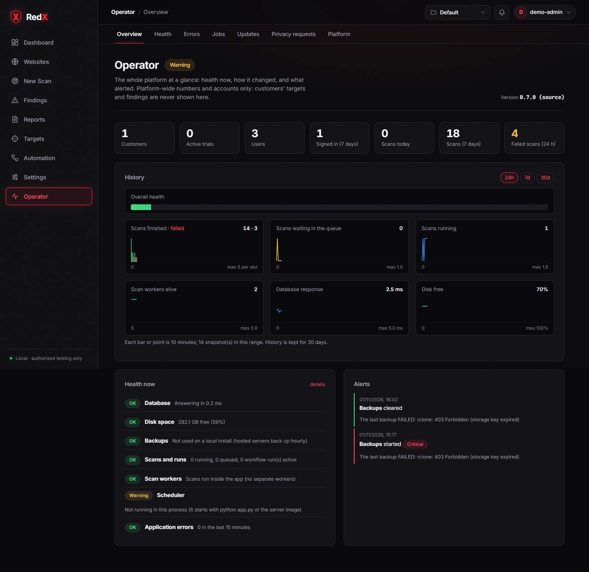

# RedX — every screen

**See the full gallery: https://redx000.github.io/redx-showcase/**

RedX is a security platform for small businesses. It does two things:

- **Website Guard** watches your websites' uptime, certificates, domains and email security, and tells you in plain English what to fix.
- **Authorised security scanning** runs on targets you have proved you own.

This repository shows how RedX looks: 3 dashboards and 27 more pages, 30 screens in all. The RedX source code is private.

| Dashboard | Websites | Operator overview |
|---|---|---|
|  |  |  |

The screens are grouped as follows:

- **Website Guard:** one website's details, and the monthly report.
- **Scanning:** new scan, scan history, findings, reports.
- **Targets and automation:** projects, ownership, workflows, schedules, changes.
- **Settings:** account, organisation, users, usage, billing, support access, audit log.
- **Operator (RedX staff only):** health, errors, jobs, updates, customers, ownership requests, privacy requests, team, platform settings.

All names, companies, websites and findings in the screenshots are labelled sample data. They were captured from demo installs on 2 November 2026.
